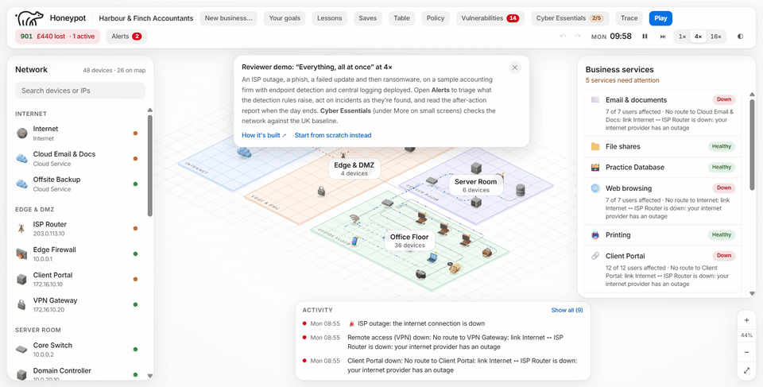

<p align="center">
  
</p>

<h1 align="center">Honeypot</h1>

<p align="center">
  <strong>A browser-based business network simulator.</strong><br />
  Build a business, watch its network run, then defend it against realistic outages and attacks.
</p>

<p align="center">
  <a href="https://github.com/adamterrelonge/HoneyPot/actions/workflows/ci.yml"></a>
  <a href="LICENSE"></a>
</p>

<p align="center">
  <a href="https://adamterrelonge.github.io/HoneyPot/"><strong>Play it in the browser</strong></a> ·
  <a href="https://adamterrelonge.github.io/HoneyPot/?demo"><strong>One-minute reviewer demo</strong></a> ·
  <a href="#case-study">Case study</a>
</p>

<p align="center">
  
</p>

---

## What it is

Honeypot generates a realistic network for a business you describe, from a small office up to a
multi-site enterprise. It draws the network on a clean isometric map with live traffic. You then
live through real-world situations and respond to them: outages, ransomware, phishing,
misconfigurations, failed firmware updates and capacity problems.

It's built for people learning how business networks behave and fail: IT generalists, students,
SME owners and security trainees. It favours **clarity over completeness** and **cause and effect
over packet-level accuracy**. Every failure can be traced back to a cause you can see.

> **Safety:** Honeypot is a closed simulation. It never touches real hosts, never scans and never
> sends network traffic beyond loading its own assets. It contains no exploit code.

## Features

- **Business generator.** Pick a name, industry, size (SME, mid-size or enterprise), number of sites,
  cloud or on-premises hosting, budget and compliance needs. A live preview shows the result.
  - Industries: Professional services, Retail, Healthcare, Manufacturing, Education, Logistics.
  - Large departments become group nodes ("Finance · 40 laptops") that expand as you zoom in.
- **Live simulation.** Runs in a Web Worker on a fixed-tick clock (pause, 1×, 4×, 16×, step).
  - Traffic is modelled as flows between services, with link utilisation, latency and loss.
  - Service dependencies: DNS → sign-in → app.
  - Animated traffic along cables that lie on the floor and follow the grid.
- **Policy and identity.** Zones, subnets and VLANs, ordered firewall rules, roles with per-app
  access and MFA.
- **Trace tool.** Pick a source and a destination to see the hop-by-hop path and the exact rule,
  link or permission that allows or blocks it.
- **Device lifecycle and firmware.** A firmware catalogue with real CVE references (checked against
  NVD and the CISA KEV list), install now or in tonight's maintenance window, brick risk, rollback,
  hardware ageing and failure, and a vulnerability exposure view.
- **Incidents and scenarios.** 14 incident types, including ransomware (office and production line),
  phishing and account takeover, DDoS, ISP outage, DNS misconfiguration, expired certificates,
  credential stuffing, a compromised software update and invoice fraud.
  - 12 scripted scenarios plus free play.
  - Business impact in £, a response budget, a running score and an after-action report.
  - Deploy **honeypot decoys** that raise the alarm when an attacker touches them.
- **Undo, saves and sharing.** Undo and redo outside games, named saves plus a daily autosave
  (IndexedDB), copyable share codes and Markdown export of the after-action report.
- **Accessibility.** Built to WCAG 2.2 AA.
  - Light and dark themes (follows the system, or toggle manually).
  - A full table view of the network for keyboard and screen-reader users.
  - Skip links, focus-managed dialogs, live announcements and reduced-motion support.
- **Security operations.** Systems write realistic logs (Windows Security events, firewall, VPN,
  email gateway, EDR, network flows). Ten detection rules in the [Sigma](https://sigmahq.io/) format
  turn them into alerts, mixed with everyday false alarms, and you triage each one: escalate to
  detect the incident at once, dismiss, or miss it. Logs export as JSON Lines.
  - Buy security tools from each game's budget: EDR, central logging (SIEM), an email security
    gateway, staff awareness training and immutable backups.
- **Speaks the industry's language.** Incidents carry MITRE ATT&CK technique IDs; the report gives
  mean time to detect, contain and resolve (MTTD, MTTC, MTTR); free play can pit you against a chosen
  threat actor, and the ransomware gang plans its route to your crown jewels and re-plans around
  your changes.
- **Cyber Essentials gap report.** Checks the network against the five controls of the UK
  government's baseline (NCSC requirements v3.3, April 2026), with one-click fixes, and lists what
  the simulation can't assess instead of assuming it passes.
- **Onboarding and learn mode.** A short, skippable start asks what you want to do and tailors the
  rest. Four hands-on lessons (identity, ransomware, patching, outages) ask for one change at a time
  and complete themselves when the network shows it, then run the matching scenario. Wording
  adapts to how familiar you are.
- **After-action report and report card.** Score, losses, response times, alert triage, objectives
  and per-incident timelines, as Markdown or a one-page PNG.
- **Guided tour.** A 10-step tour of the real UI, offered after you create a business.
- **Desktop, tablet and phone.** Landscape and portrait tablet layouts with touch pan and
  pinch-zoom; on phones (down to 320 px wide, which also covers 400% browser zoom) panels take the
  full height.

## Getting started

Requirements: **Node.js 20+** (developed on Node 24) and npm.

```bash
git clone https://github.com/adamterrelonge/HoneyPot.git
cd HoneyPot
npm install
npm run dev
```

Open the URL Vite prints (usually <http://localhost:5173>). Create a business, or choose
**Use the sample business**, then press **Play**.

### Scripts

| Command | What it does |
|---|---|
| `npm run dev` | Start the Vite dev server |
| `npm run build` | Production build into `dist/` |
| `npm run preview` | Serve the production build locally |
| `npm run typecheck` | Type-check the app and the engine (separate configs) |
| `npm test` | Run the Vitest suite |
| `npm run check` | Typecheck, test and build in one go |
| `npm run build:wasm` | Build the Rust engine to WebAssembly (needs Rust and the `wasm32-unknown-unknown` target); enables the parity tests |

### Controls

| Action | Input |
|---|---|
| Pan the map | Drag (one finger on touch) |
| Zoom | Mouse wheel or pinch |
| Select a device | Click or tap it, or pick it from the device list |
| Pause / resume | <kbd>Space</kbd> |
| Close a panel or clear selection | <kbd>Esc</kbd> |

Add `?demo` to the URL for the reviewer demo (nothing is saved). Dev only: `?stress=200` loads a
synthetic 200-node topology.

## Tech stack

| Concern | Choice |
|---|---|
| Build | Vite 8 |
| UI | React 19, TypeScript 7 (`strict`) |
| Rendering | PixiJS 8 (WebGL), isometric scene |
| State | Zustand 5 |
| Graph | graphology |
| Schemas | Zod 4 |
| Worker RPC | Comlink 4 |
| Styling | Tailwind CSS 4 and CSS custom properties |
| Tests | Vitest; generator golden hashes; Lighthouse for accessibility |
| CI | GitHub Actions: web app, Rust engine and API jobs |
| Engine hot paths (draft) | Rust → WebAssembly (`engine-rs/`) |
| Backend (draft, optional) | Python: FastAPI, Pydantic, SQLAlchemy (`api/`) |

## Architecture

```
┌──────────────── Main thread ────────────────┐      ┌────────── Web Worker ─────────┐
│ React UI  (TopBar, Sidebar, Inspector, …)   │      │ Engine (pure TypeScript)      │
│   │ intents ▼          ▲ UI state           │ cmd  │  World  (graphology)          │
│ Zustand store (selection, panels, mode)     │─────►│  Clock  (fixed tick, speed)   │
│   │ subscribe                               │◄─────│  Flows / Reachability / Policy│
│ Pixi Scene (grid, zones, links, nodes, fx)  │ snap │  Incidents / Scenario runner  │
└─────────────────────────────────────────────┘      │  Seeded RNG, Command log      │
                                                     └───────────────────────────────┘
```

Core principles:

1. **The engine is pure TypeScript.** `src/engine/**` never imports React, Pixi, Zustand or the DOM.
   `tsconfig.engine.json` enforces this.
2. **Simulation state never lives in React.** The worker pushes read-only snapshots, and React holds
   UI state only.
3. **Every change is a command**, which enables undo, replay, saves and after-action reports.
4. **Deterministic.** All randomness uses a seeded RNG, so the same seed and commands always give the
   same result.
5. **Simulate flows, not packets.**

```
src/
  engine/    pure TS simulation: model, catalogue, graph, sim/, gen/, policy/, firmware/, incidents/,
             soc/ (logs, Sigma rules, alerts), compliance/ (Cyber Essentials), save/
  worker/    sim.worker.ts (owns the simulation), wire.ts (compact snapshot transport)
  render/    isometric maths, cable routing, Pixi scene, theme
  state/     UI store, snapshot mirror, preferences, viewport
  persist/   IndexedDB saves, share codes
  ui/        React panels, wizard, tour, accessibility components
  wasm/      loader and parity tests for the Rust engine
  data/      sample topology
public/emoji device, industry and logo artwork
engine-rs/   Rust port of engine hot paths, compiled to WebAssembly (draft)
api/         optional FastAPI backend: share links and leaderboards (draft)
```

## Beyond the browser (drafts)

Two optional extensions. Neither is needed to run Honeypot.

**Rust → WebAssembly engine (`engine-rs/`).** Firewall policy evaluation, which runs for every
traffic flow on every tick, is ported line for line from TypeScript. The TypeScript engine stays
the reference, and parity tests check that both give identical decisions (allowed, deciding rule
and reason text) for 2,000 random flows on a generated business in each of the six industries.

The first version passed JSON across the boundary and was **3–4× slower** than TypeScript:
serialising cost more than the rule check. The second keeps the topology resident in WASM memory,
interns strings to integers and exchanges typed arrays. Measured on 100,000 decisions (Node 24):

| Rules | TypeScript | Rust/WASM (resident) | Speed-up |
|---|---|---|---|
| 7 | 15.4 ms | 2.8 ms | 5.4× |
| 60 | 102 ms | 12.2 ms | 8.3× |

The simulation doesn't use it yet. Next steps are flow routing, then the whole tick loop.

**FastAPI backend (`api/`).** Share links (publish a save, open it anywhere by a short id) and
per-scenario leaderboards. The server checks a save's envelope and stores it as received; the
browser engine validates it and checks its hash when it is opened. Grades are computed on the
server. See [`api/README.md`](api/README.md) for endpoints, configuration and what's still to do.

[`build.md`](build.md) is the full design reference: architecture, domain model, an abstraction
ledger of what is and isn't simulated, and the phase plan. [`BUILD_DIARY.md`](BUILD_DIARY.md)
records what was built in each phase, with test results and decisions.

## Case study

**The problem.** Network security is usually taught either with slides, which don't show cause and
effect, or with real labs, which are expensive to run and easy to get wrong. I wanted something in
between: a business you can see, that behaves plausibly, where every failure traces back to a cause,
and that anyone can open in a browser for free.

**Constraints I set.** Free to host and run, so a static site with no server. Offline-first. No
real network traffic and no exploit code. Realistic enough that the vocabulary transfers to a real
job.

**Key decisions and their trade-offs.**

- **Flows, not packets.** Traffic is modelled as flows between services with bandwidth, latency and
  loss, not individual packets. That keeps a 200-node business under 10 ms a tick in a Web Worker, at
  the cost of anything packet-level (fragmentation, TCP behaviour). [`build.md`](build.md) keeps an
  abstraction ledger of what is and isn't simulated.
- **Deterministic engine, everything a command.** All randomness is seeded and every change is a
  logged command. That one decision gave undo and redo, saves verified by a state hash, share codes,
  whole-game replay tests and after-action timelines. The cost is discipline: new state is saved only
  when it differs from the default, so older saves keep the same hash.
- **Grounded in real sources, checked rather than remembered.** CVEs and scores were checked against
  NVD and the CISA KEV catalogue, ATT&CK IDs against attack.mitre.org (one I couldn't confirm was
  left out), the Cyber Essentials checks against the NCSC's v3.3 requirements, detection rules in the
  Sigma format, and log addresses in the RFC 5737 documentation ranges.
- **Measure before porting.** The first Rust/WebAssembly port of firewall evaluation was 3–4×
  *slower* than TypeScript, because serialising across the boundary cost more than the work. Keeping
  the topology resident in WASM memory made it 5–8× faster. It isn't wired in yet because TypeScript
  is still fast enough.
- **Dropped the backend.** A FastAPI service for share links and leaderboards works and is tested,
  but hosting it means paid plans or cold starts. It stays a draft, and the site stays static on
  GitHub Pages.

**Things that went wrong, and what they taught me.**

- Data theft cost 0.08 points per MB, so any long exfiltration floored the score at 0. Rebalancing
  it to a capped log scale revealed a second bug the floor had hidden: after a game ended, open
  incidents' containment clocks kept running, so the "final" score kept falling. Clamps hide bugs;
  test the unclamped value.
- Recording the demo GIF showed "undefined recovered" in the activity feed: labels for apps that
  incidents inject (data leaving the network, DDoS) were never cached. A regression test now runs
  the multi-incident scenario and checks every event.
- Wall-clock performance tests fail on a busy laptop running 20+ test files in parallel. They pass
  alone and in CI, and are documented rather than loosened.

**Results.** 252 tests across 26 files in the web app (plus 7 WASM parity tests and 8 Rust tests),
CI on every push, deploys from CI to GitHub Pages. The main bundle is 84 KB gzipped, with PixiJS
split into its own 191 KB chunk. Lighthouse scored 100 for accessibility, best practices and SEO
at phone and tablet sizes when last audited (Phase 10).

**What I'd do next.** An investigation view (all logs for a host around an alert), a rule editor
that replays a game to show alerts gained and lost, credentials and privilege in the attack
planner, and a manual screen-reader audit.

## Project status

Phases 1–14 are complete: foundation, simulation core, business generator, policy and trace,
firmware lifecycle, incidents and scoring, saves and sharing, accessibility and performance,
content plus tablet support, release readiness, onboarding, the industry's language (ATT&CK,
response metrics, threat actors, attack planner, report card), detection and triage, and learn
mode with the Cyber Essentials gap report. [`BUILD_DIARY.md`](BUILD_DIARY.md) has each phase's
tests, issues and debt.

Known limitations:

- Layout at 200% and 400% zoom has been checked, but there hasn't yet been a manual audit with
  real screen readers (NVDA, VoiceOver) or in Windows high-contrast mode.
- The map itself is pointer and touch only. Keyboard users work through the device list, inspector
  and table view.
- On phones the map is small and best used with the device list; the layout is designed for
  tablets and up.
- Saves live in your browser's IndexedDB. Use share codes to move a business between browsers
  (the draft backend adds share links).

## Credits

Designed and built by **Adam Terrelonge**.

The Honeypot logo, the industry images (`public/emoji/industry-*.png`) and the ISP device image
are original artwork by Adam Terrelonge, released with the project under the MIT licence.

Other device artwork uses [Microsoft Fluent Emoji](https://github.com/microsoft/fluentui-emoji) (MIT).
See [`public/emoji/LICENSE-fluentui-emoji.txt`](public/emoji/LICENSE-fluentui-emoji.txt).

CVE data references public records from the [NVD](https://nvd.nist.gov/) and the
[CISA Known Exploited Vulnerabilities](https://www.cisa.gov/known-exploited-vulnerabilities-catalog)
catalogue.

## License

[MIT](LICENSE). Third-party artwork keeps its own licence (see Credits).
